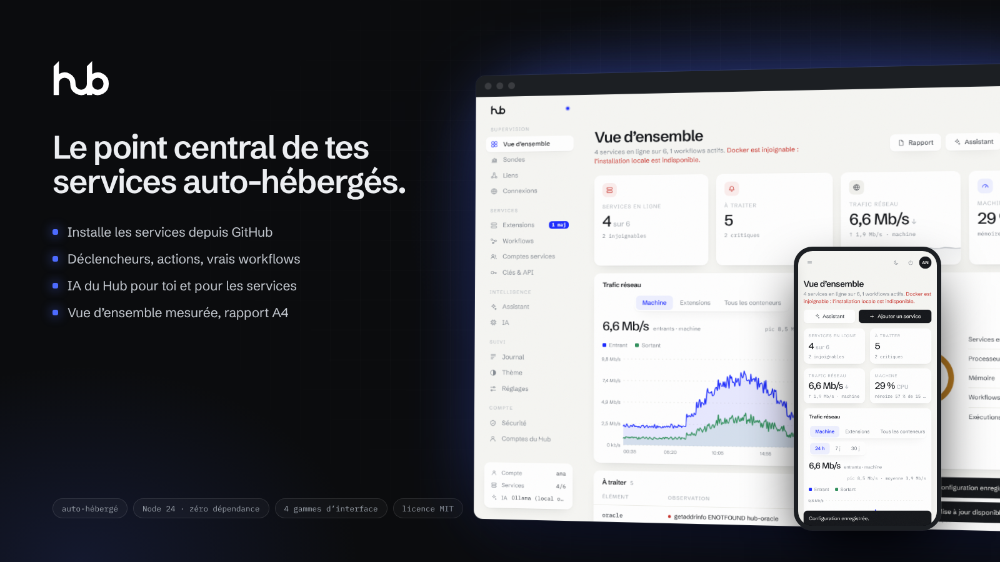
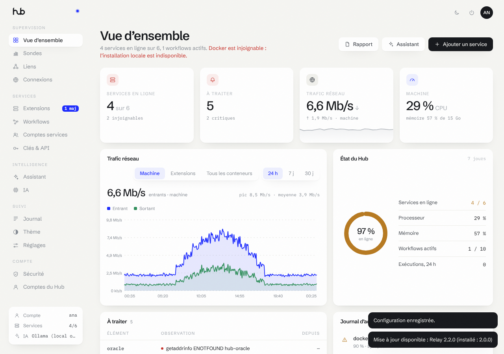
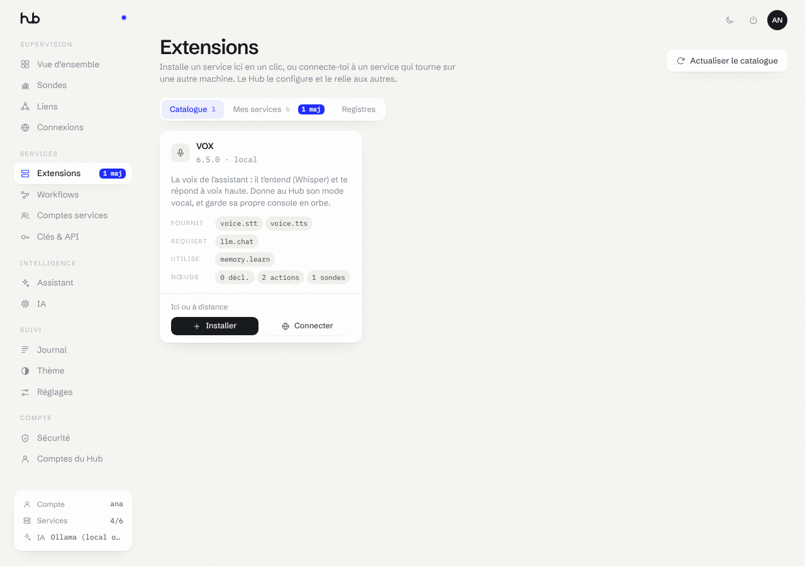
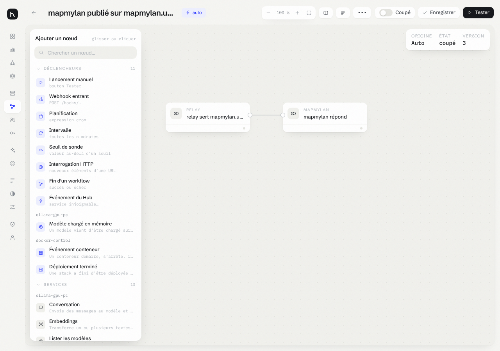
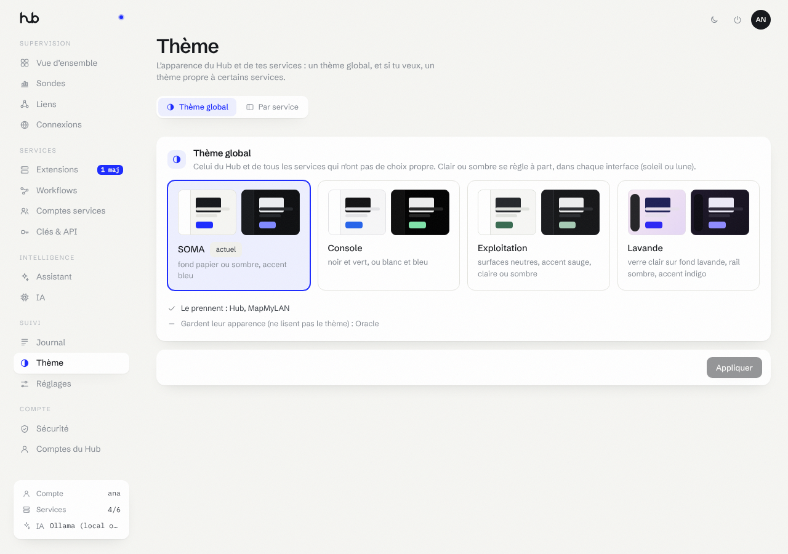

<p align="center">
  <picture>
    <source media="(prefers-color-scheme: dark)" srcset="medias/logo-sombre.svg">
    
  </picture>
</p>

<p align="center"></p>

# Nesaris Hub

**The central point of your self-hosted services: one-click installs from GitHub, real workflows between services, and an AI assistant that proposes configs — you click to apply.**

<p align="center">

[](https://github.com/Nesaris/Hub/stargazers)
[](LICENSE)


</p>

<p align="center"><a href="README.fr.md">Full documentation</a> · <a href="https://nesaris.github.io">Nesaris Network</a></p>

## Why Hub?

Running a homelab means juggling a dozen containers, configs and dashboards. The Hub installs and wires your services together, connects to the ones running on other machines (like Ollama on another PC), and lets them trigger each other.

## Features

- **One-click installs** of services straight from GitHub, as extensions.
- **Workflows** between services: triggers, actions and probes exposed by each service, with a visual editor.
- **AI assistant** that proposes configurations — by default every plan waits for your click.
- **Measured overview** — network traffic of the host and of each extension, CPU, memory, service uptime over 24 h / 7 d / 30 d, printable as an A4 report.
- **Secure by design** — Docker driven through a socket proxy (never the raw socket), secrets sealed with master keys stored outside the data volume, Argon2id passwords, passkeys, TOTP and a security log.
- **Zero npm dependencies**, SQLite (`node:sqlite`), no build step, light & dark themes.

## Screenshots

<table>
<tr><td align="center" width="50%"><br><sub>Measured overview</sub></td><td align="center" width="50%"><br><sub>Extension catalog</sub></td></tr>
<tr><td align="center" width="50%"><br><sub>Workflow editor</sub></td><td align="center" width="50%"><br><sub>Themes</sub></td></tr>
</table>

## Quick start

```bash
git clone https://github.com/Nesaris/Hub hub && cd hub && sudo ./install.sh
```

The script installs Docker if needed, creates the master keys, builds and starts the Hub on `127.0.0.1:8100`, and prints the one-time setup token. Put an HTTPS reverse proxy in front (Caddy, Traefik, [Relay](https://github.com/Nesaris/Relay), Cloudflare Tunnel) to reach it from your network.

Full documentation (configuration, backups, key rotation, reverse proxy, upgrades) is in **[README.fr.md](README.fr.md)**.

## Part of Nesaris Network

Hub is one of the self-hosted tools of **[Nesaris Network](https://nesaris.github.io)**. Every service shares the same hardened core (accounts, passkeys, TOTP, audit log, encrypted secrets), runs on Node.js 24 with **zero npm dependencies**, and can be installed in one click from the **[Nesaris Hub](https://github.com/Nesaris/Hub)**.

Other projects: [MapMyLAN](https://github.com/Nesaris/MapMyLAN) · [NexArc](https://github.com/Nesaris/NexArc) · [ProxLab](https://github.com/Nesaris/ProxLab) · [Vigie](https://github.com/Nesaris/Vigie) · [Relay](https://github.com/Nesaris/Relay) · [Nesmail](https://github.com/Nesaris/Nesmail) · [Synapse](https://github.com/Nesaris/Synapse) · [Dialekt](https://github.com/Nesaris/Dialekt)

## Contributing

Issues and pull requests are welcome. If Hub is useful to you, a ⭐ helps a lot — it's how other people find the project.

## License

[MIT](LICENSE) — made by [CodeX64](https://codexx64.github.io).
