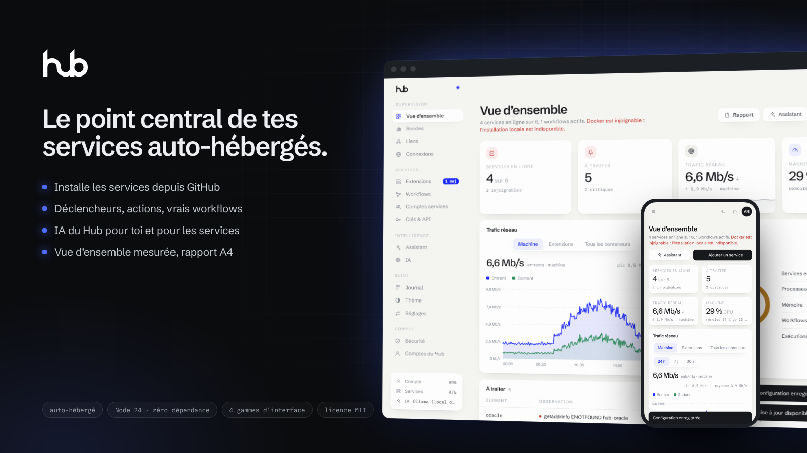
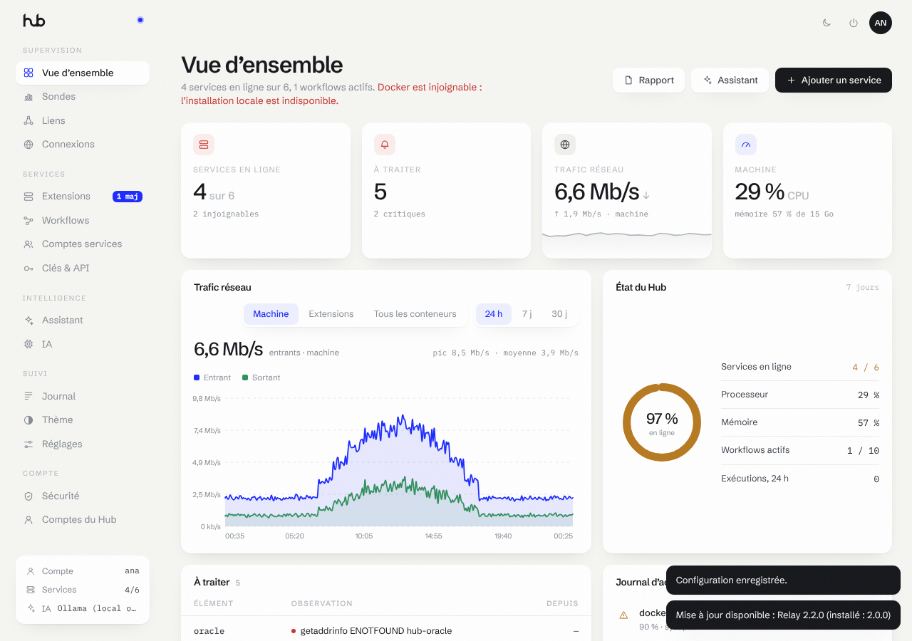
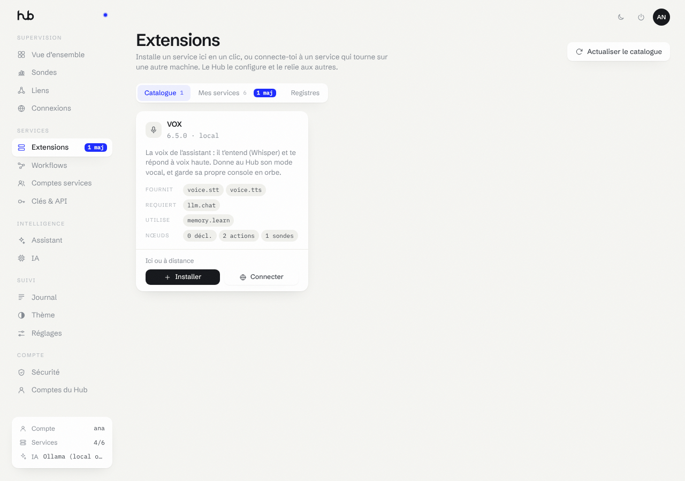
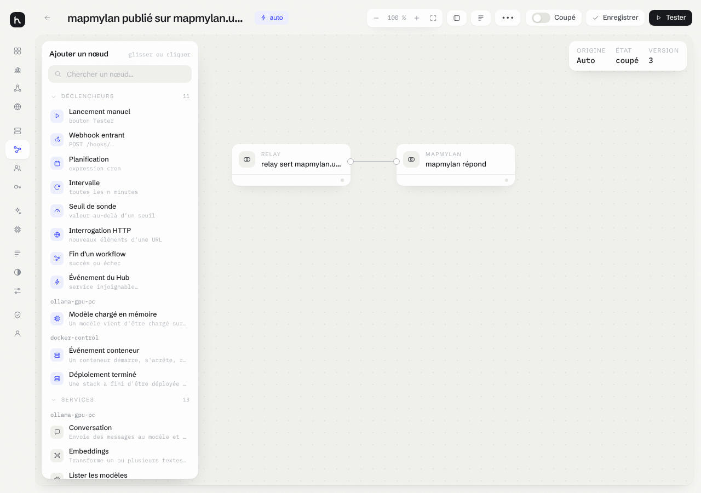
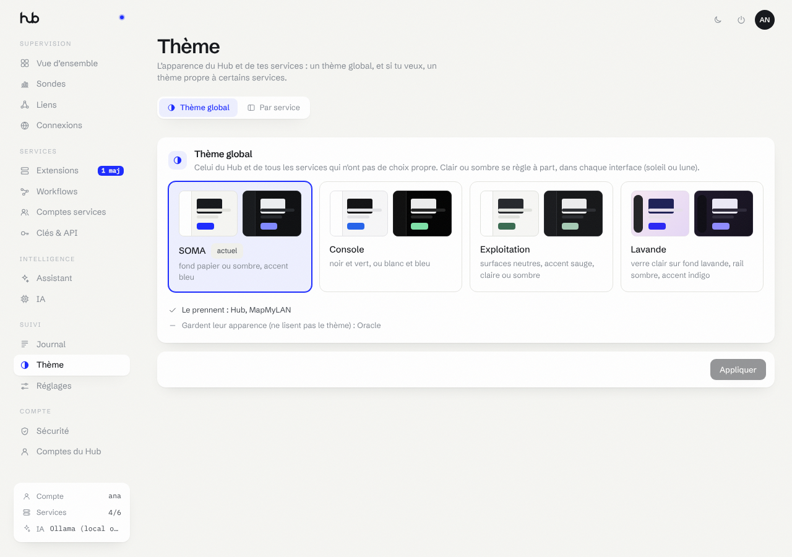
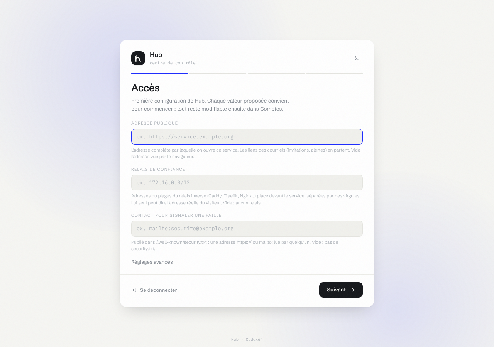

<p align="center">
  <picture>
    <source media="(prefers-color-scheme: dark)" srcset="medias/logo-sombre.svg">
    
  </picture>
</p>

<p align="center"></p>

# Hub

Point central de tes services auto-hébergés. Le Hub installe tes services depuis GitHub, se connecte à ceux qui tournent sur d'autres machines (Ollama sur un autre PC, par exemple), expose leurs déclencheurs, actions et sondes, et fait tourner de vrais workflows entre eux. Un assistant IA propose les configurations ; par défaut, chaque plan attend ton clic.

- Backend Node.js 24 **sans aucune dépendance npm**, base SQLite (`node:sqlite`), mots de passe en Argon2id natif.
- Comptes, sessions, seconds facteurs et journal de sécurité fournis par le socle commun (`socle/`), le même que les autres services.
- Interface web sans étape de compilation, au design SOMA (clair et sombre), repliée de 360 à 1920 px.
- Docker piloté à travers un proxy de socket, jamais avec le socket monté en direct dans le Hub.
- Vue d'ensemble mesurée : trafic réseau de la machine et de chaque extension, processeur, mémoire, disponibilité des services, sur 24 h, 7 jours ou 30 jours, imprimable en rapport A4.

## Aperçu

|  |
|:--:|
| Vue d’ensemble mesurée |

|  |
|:--:|
| Le catalogue des extensions |

|  |
|:--:|
| L’éditeur de workflows |

|  |
|:--:|
| Le thème : une gamme pour tout, ou une par service |

Quatre gammes d’interface au choix — SOMA, Console, Exploitation, Lavande — en clair ou en sombre, de 360 à 1920 px de large.

## Installation

```bash
git clone https://github.com/CodexX64/hub && cd hub && sudo ./install.sh
```

Le script :

- installe Docker depuis les paquets de la distribution s'il manque (aucun script téléchargé n'est exécuté) ;
- copie le projet dans `/opt/hub` ;
- crée `.env` à partir de `.env.example` ;
- crée les deux clés maîtresses dans `/opt/hub/secrets`, montées en secrets Docker : le volume de données seul ne déchiffre rien (une installation existante garde ses clés) ;
- construit l'image (Node 24 épinglé par empreinte) et démarre le Hub avec son proxy de socket ;
- affiche l'adresse et le **jeton d'installation** demandé à la création du premier compte.

Le Hub n'écoute que sur `127.0.0.1:8100`. Pour y accéder depuis ton réseau, pose un relais HTTPS devant (Caddy, Traefik, Relay, Cloudflare Tunnel) et déclare-le dans `SOCLE_PROXYS`.

Sauvegarde `/opt/hub/secrets` à part du volume : sans ces clés, les secrets chiffrés du volume sont perdus.

```bash
sudo ./install.sh --uninstall   # arrête le Hub, garde les données
sudo ./install.sh --purge       # supprime aussi les données du Hub
```

Sans Docker (développement) :

```bash
npm run dev      # http://localhost:8100, données dans ./data
npm test         # tests unitaires et parcours complet contre de faux services
```

## Première connexion

Un administrateur tient deux facteurs, dont une **clé d'accès** (passkey). Le navigateur n'en crée une que sur HTTPS par un nom, ou sur `localhost` — pas sur une adresse IP. Le Hub capte seul d'où on l'ouvre : par son adresse IP (`https://10.0.0.2:8100`, par exemple), identifiant, mot de passe et TOTP suffisent, la clé n'est ni proposée ni exigée ; par son nom en HTTPS, elle est demandée à l'administrateur qui n'en a pas encore, et créée là.

1. Ouvre le Hub par son adresse IP, par HTTPS avec un nom, ou par un tunnel SSH : `ssh -L 8100:127.0.0.1:8100 <serveur>`, puis **http://localhost:8100**.
2. Colle le jeton d'installation. Il est affiché par `install.sh`, et dans les journaux : `docker compose -f /opt/hub/compose.yml logs hub | grep "Jeton d'installation"`.
3. Crée le compte administrateur, puis sa clé d'accès. Le TOTP se configure par un QR code généré sur place, sans service tiers. Des codes de secours te sont donnés une seule fois.
4. Ajoute une IA, page IA : Ollama (local ou sur une autre machine), une clé d'API (Claude, GPT, Gemini, Kimi, Mistral, OpenRouter — rangée dans Clés & API), ou ton abonnement via l'outil (Claude Code, Codex). Tu peux aussi le faire plus tard.

Une clé d'accès est liée au nom d'hôte : celle créée sur `localhost` ne sert pas sur ton domaine HTTPS. Une fois le Hub publié sous un nom (Connexions → Publier le Hub), ouvre-le par ce nom : la clé t'est demandée, et se crée depuis **Compte → Sécurité**.

`SOCLE_HTTP=1` ouvre un mode HTTP dégradé (aucune clé d'accès nulle part, bandeau permanent) : inutile pour l'accès par l'adresse IP, à réserver à un Hub servi en HTTP simple derrière un relais qu'on ne peut pas déclarer.

### Depuis une version 0.5

Les comptes existants sont repris au premier démarrage : mots de passe et secrets TOTP conservés, rôles gardés. Les sessions ouvertes sont fermées, et le code d'appairage disparaît. Un administrateur sans clé d'accès en crée une à sa prochaine connexion par un nom en HTTPS ou par `localhost` ; par l'adresse IP, il entre avec ses deux autres facteurs.

## Première configuration et mises à jour

Au premier démarrage, ouvre l’interface : tu crées le compte administrateur avec
le jeton d’installation (affiché dans les journaux du conteneur, ou transmis par
le Hub), tu inscris tes facteurs de connexion, puis l’**assistant de
configuration** passe les réglages de Hub groupe par groupe. Il est
obligatoire : Hub reste fermé tant qu’il n’est pas terminé. Chaque valeur
proposée convient pour commencer.

<p align="center"></p>

Réglages demandés : catalogue des extensions, adresse du Hub vue des services, appels à l’IA par jour au plus, jetons d’IA par jour au plus, appels par jour pour un service ; plus ceux de
tous les services (adresse publique, relais de confiance, gamme de
l’interface, contact de sécurité, courriels d’alerte).

Après une mise à jour qui apporte un réglage nouveau, l’assistant revient au
passage suivant d’un administrateur et ne demande **que ce réglage-là**. Une
mise à jour sans réglage nouveau ne demande rien : une fenêtre « Quoi de neuf »
résume ce qu’elle apporte, une fois par compte, et se ferme d’un clic
(`nouveautes.json`).

Tout reste modifiable dans **Comptes → Réglages du service**. Une variable
posée dans l’environnement l’emporte toujours et n’est pas demandée. Hub
redémarre seul pour appliquer un changement (le processus du conteneur le
supervise). Les valeurs vivent dans `reglages.json`, dans le volume de
données ; les secrets y sont scellés par la clé maîtresse.

## Sauvegardes

Le Hub écrit une sauvegarde chiffrée de sa base pour une clé publique RSA ; la clé privée reste sur une autre machine. Le Hub sait écrire une sauvegarde, pas la relire.

```bash
# Sur une autre machine : la paire de clés, une fois.
openssl genpkey -algorithm RSA -pkeyopt rsa_keygen_bits:3072 -out hub-sauvegarde.pem
openssl pkey -in hub-sauvegarde.pem -pubout -out hub-sauvegarde.pub.pem
# Sur la machine du Hub : la clé publique seulement, puis une sauvegarde.
sudo cp hub-sauvegarde.pub.pem /opt/hub/secrets/sauvegarde.pub
docker exec hub node server/cli.js sauvegarde > hub-$(date -u +%F).sauv
# Restauration, sur une autre machine avec le dépôt : un fichier neuf, jamais écrasé.
node server/cli.js restaurer hub-sauvegarde.pem hub.db < hub-AAAA-MM-JJ.sauv
```

Planifie la commande (cron quotidien), envoie le fichier hors de la machine, garde-en trente jours, et fais au moins une restauration d'essai : une sauvegarde jamais relue n'en est pas une. Les clés maîtresses (`/opt/hub/secrets`) se sauvegardent à part.

## Tourner une clé

La base retient l'empreinte de contrôle de la clé qui l'a écrite : un démarrage avec une autre clé s'arrête au lieu de perdre les secrets. Pour remplacer une clé maîtresse, pose la neuve et garde l'actuelle dans le fichier `_ancienne` le temps d'un redémarrage : le Hub rescelle tout sous la neuve, en une transaction, et le journal note `coffre.tourné`.

```bash
cd /opt/hub
# HUB_CLE (clés d'API, variables, réglages des services, secrets des workflows et des webhooks)
sudo sh -c 'cp secrets/hub_cle secrets/hub_cle_ancienne && head -c 32 /dev/urandom | base64 -w0 > secrets/hub_cle && chown 1001:1001 secrets/hub_cle* && chmod 400 secrets/hub_cle*'
docker compose up -d --force-recreate hub && docker logs hub 2>&1 | grep 'clé tournée'
sudo sh -c ': > secrets/hub_cle_ancienne' && docker compose up -d --force-recreate hub
# SOCLE_CLE (secrets TOTP des comptes) : même geste avec socle_cle et socle_cle_ancienne ;
# le journal de sécurité note coffre.tourne, personne ne réinscrit son application.
```

`node outils/exercice-rotation.mjs` rejoue ce geste de bout en bout sur une instance jetable (compte avec TOTP, clé d'accès et codes de secours, variable secrète, webhook), puis vérifie que tout tient.

Garde l'ancienne clé hors ligne, avec les sauvegardes faites sous elle : une base restaurée ne se lit qu'avec la clé qui l'a écrite (la poser alors dans le fichier `_ancienne` fait la rotation au démarrage). Le secret d'un webhook se remplace depuis l'éditeur (« Nouveau secret ») : il n'est montré qu'à ce moment-là, puis gardé chiffré.

## Réglages

Tous les réglages de démarrage passent par `.env` (voir `.env.example`). Une valeur invalide arrête le Hub au démarrage avec la liste des erreurs.

L'apparence se règle dans l'interface, page Thème : SOMA (fond papier ou sombre, accent bleu) ou Console (noir et vert, ou blanc et bleu, en Geist). Un thème pour tout, ou un par service, le Hub compris. Les services qui lisent le thème et dont la gamme change sont redéployés pour la recevoir ; Oracle et SYNAPSE gardent la leur. Clair ou sombre se règle dans chaque interface.

| Préfixe | Rôle |
| --- | --- |
| `HUB_*` | Le Hub : adresse publique, registre, réseau Docker, sondes, niveau de journal. |
| `SOCLE_*` | Le socle commun : jeton d'installation, relais de confiance, mode HTTP, contact de sécurité, alertes par courriel (SMTP). |

## Principes

| Élément | Rôle |
| --- | --- |
| **Extension** | Un service décrit par un fichier `hub.json` (voir `docs/hub-extension.schema.json`). Le catalogue vient des dépôts du compte GitHub `CodexX64` qui portent un `hub.json` à la racine (`github-user:CodexX64`) et du dossier `registry-local/`. |
| **Instance** | Une extension ajoutée au Hub, de deux façons : **installée ici** (Compose sur la machine du Hub) ou **distante** (le service tourne ailleurs, le Hub s'y connecte par son adresse). |
| **Capacités** | Chaque service déclare ce qu'il fournit, ce qu'il exige et ce qu'il utilise. Le Hub relie automatiquement les services compatibles. |
| **Workflows** | Tout lien entre services est un workflow visible (Auto, IA ou Manuel). Aucun lien caché. |
| **Déclencheurs** | Ceux des services (webhook signé, interrogation, flux SSE ou WebSocket) et les déclencheurs intégrés : manuel, cron, intervalle, webhook libre, interrogation HTTP libre, seuil de sonde, fin d'un workflow, événement du Hub. |
| **Mesures** | Un relevé par minute, gardé trente et un jours par tranches de cinq minutes. Les conteneurs sont lus par le proxy de socket ; la machine (cartes réseau physiques, processeur, mémoire) par le petit conteneur `hub-mesure`, sur le réseau de l'hôte, sans droit ni port, qui ne fait que recopier les compteurs du noyau dans un volume lu par le Hub. Sans lui, seuls les conteneurs sont mesurés. |
| **Sondes** | Valeurs lues périodiquement, avec niveaux warn et crit et un historique. Elles servent aussi de déclencheur. |
| **IA** | Toutes les IA du Hub, page IA, de trois façons : locale (Ollama), par clé d'API (la clé va dans Clés & API, masquée ; la connexion n'en garde que le nom), ou par abonnement via l'outil — le petit conteneur `hub-outils-ia` porte Claude Code et Codex, tu y connectes ton compte une fois (`docker exec -it hub-outils-ia claude setup-token`, `docker exec -it hub-outils-ia codex login --device-auth`), et le Hub lance l'outil lui-même à chaque appel, sans ses outils (ni fichiers ni commandes). Le conteneur est sur un réseau à part et ne répond qu'au Hub (jeton `secrets/pont_jeton`, créé par `install.sh`). Chaque service choisit ensuite son IA dans sa fiche ou depuis son lien, page Workflows ; les outils par abonnement lui sont fermés, sauf s'il est nommé dans `HUB_IA_SERVICES_OUTILS`. |
| **IA pour les services** | Un service qui a besoin d'une IA reçoit l'adresse de la passerelle IA du Hub (réseau interne, port 8101, un jeton par service) : toutes les IA de la page IA, par une API Ollama et OpenAI. Les modèles d'Ollama gardent leur nom ; les autres se nomment `connexion/modèle` (`claude-code/sonnet`). Voir `docs/IA-POUR-LES-SERVICES.md`. |
| **Clés & API** | Les jetons de tes services, scellés. L'assistant en connaît les noms, jamais les valeurs. Toi, tu peux en dévoiler une : clé d'accès, ou mot de passe et code ensemble, pour deux minutes, et la lecture va au journal. |
| **Assistant** | Transforme une demande en plan (installer, connecter, créer un workflow…). En mode Validation (par défaut), rien n'est exécuté sans ton clic, hormis un message qu'un administrateur envoie sur un de ses canaux ; en Autonome, seul ce qui se défait part seul, et supprimer, installer, régler un service ou envoyer des données ailleurs attend toujours ton accord. |

## Structure

```
server/            API, moteur, déclencheurs, sondes, IA (Node.js, zéro dépendance)
socle/             socle commun : comptes, facteurs, sessions, journal, design SOMA
web/               interface (HTML, CSS, modules JS)
docs/              schéma des manifestes, exemples, état du projet
registry-local/    extensions livrées avec le Hub (Ollama, VOX)
registry-template/ modèle du dépôt hub-registry (index + extension exemple)
test/              tests node:test et faux services
outils/            vitrine, parcours navigateur (mise en page), exercice de rotation des clés
outils-ia/         pont vers Claude Code et Codex (conteneur hub-outils-ia)
```

- `docs/ETAT.md` : ce qui fonctionne et ce qui reste à faire.
- `docs/CREER-UNE-EXTENSION.md` : rendre un service installable par le Hub.
- `SECURITY.md` : état de conformité, contrôle par contrôle.
- `NO-VIBE.md` : relecture du code selon la partie III du manuel.
